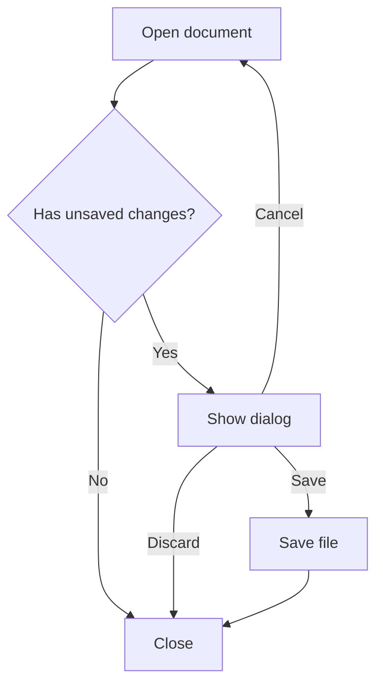
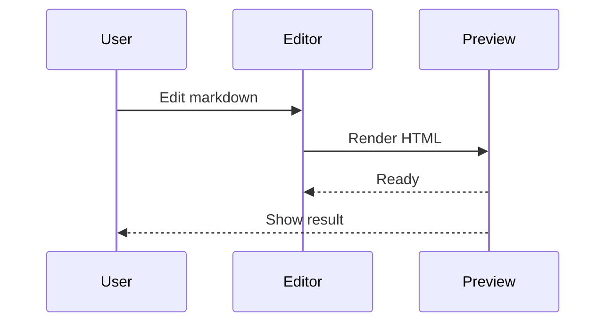
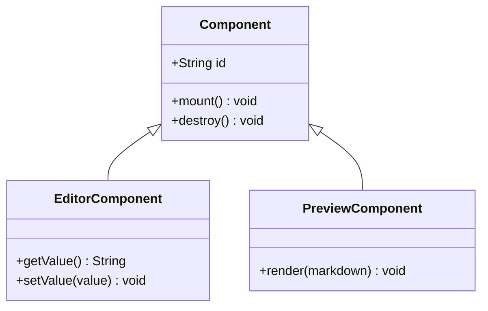
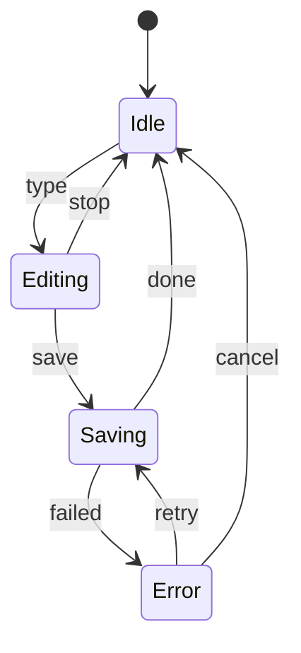
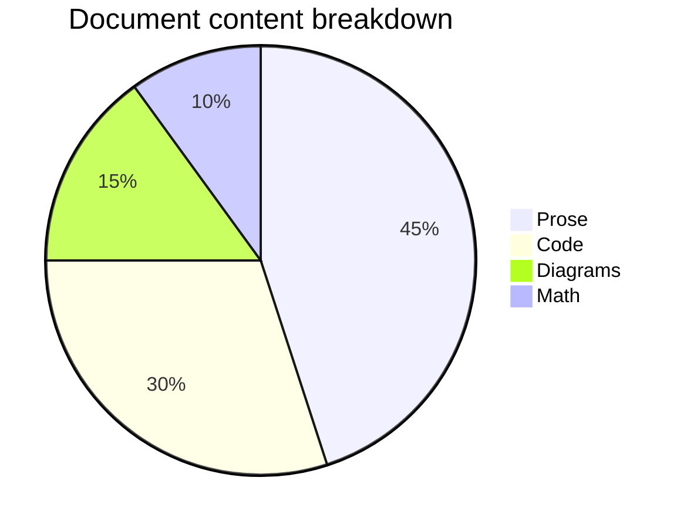

# Markdown Editor Capabilities Test

This document exercises every feature of the Markdown Editor. Open it in the app,
enable the **KaTeX** and **Mermaid** plugins (Settings → Plugins), and toggle the
preview with the split view (try the **Horizontal Split** plugin too).

- [ ] Working task list item (click it in the preview)
- [x] Completed task list item

---

## Table of Contents

1. [Headings](#1-headings)
2. [Text emphasis](#2-text-emphasis)
3. [Lists](#3-lists)
4. [Links](#4-links)
5. [Images & GIFs](#5-images)
6. [Blockquotes](#6-blockquotes)
7. [Code](#7-code)
8. [Tables](#8-tables)
9. [KaTeX math](#9-katex-math)
10. [Mermaid diagrams](#10-mermaid-diagrams)
11. [Footnotes](#11-footnotes)
12. [Miscellaneous](#12-miscellaneous)

---

## 1. Headings

# Heading level 1
## Heading level 2
### Heading level 3
#### Heading level 4
##### Heading level 5
###### Heading level 6

---

## 2. Text emphasis

- **Bold text** and __bold with underscores__
- *Italic text* and _italic with underscores_
- ***Bold and italic*** — ~~strikethrough~~
- Inline `code` with `backticks and $math-like$ text`
- Escaped characters: \*literal asterisks\*, \_literal underscores\_, \[brackets\]

---

## 3. Lists

Unordered:
- First item
- Second item
  - Nested item
    - Deeper nesting
- Third item

Ordered:
1. Step one
2. Step two
   1. Sub-step
   2. Sub-step
3. Step three

Mixed:
1. Ordered item
   - Unordered child
   - Another child
2. Back to ordered

---

## 4. Links

- [External link](https://www.markdownguide.org/cheat-sheet/)
- [Link with a title](https://commonmark.org/ "CommonMark specification")
- [Relative file link](README.md)
- [Anchor link to a section](#1-headings)
- [Reference-style link][ref] with the definition at the bottom
- Autolinks: <https://example.com> and <someone@example.com>
- Bare URL: https://example.com

[ref]: https://daringfireball.net/projects/markdown/ "Daring Fireball: Markdown"

---

## 5. Images

Inline image:


Image with link wrapper:

[](https://github.com)

### Animated GIFs

GIFs go through the same `` pipeline and should animate inline:


GIF wrapped in a link:

[](https://commons.wikimedia.org/wiki/File:Animhorse.gif)

> Note: if images or GIFs don't load, the app may be offline or blocking remote content. Heavy GIFs can also slow down preview rendering.

---

## 6. Blockquotes

> Simple blockquote.
>
> > Nested blockquote.
> >
> > - With a list inside
> > - Second item
>
> Back to the outer level.

> **Tip:** blockquotes can contain *any* other Markdown, including
> `inline code`, [links](#4-links), and even math like $x^2 + y^2 = z^2$.

---

## 7. Code

Inline: use the `printf("hello %s\n", name)` function, or ``code with `backticks` inside``.

Fenced JavaScript:

```js
function fibonacci(n) {
  if (n <= 1) return n;
  return fibonacci(n - 1) + fibonacci(n - 2);
}

console.log(fibonacci(10)); // 55
```

Fenced Python:

```python
def quicksort(items):
    if len(items) <= 1:
        return items
    pivot = items[0]
    return (
        quicksort([x for x in items[1:] if x < pivot])
        + [pivot]
        + quicksort([x for x in items[1:] if x >= pivot])
    )
```

Fenced JSON:

```json
{
  "editor": "Markdown Viewer",
  "features": ["preview", "tabs", "plugins", "themes"],
  "version": 1
}
```

Diff view:

```diff
- const oldSyntax = true;
+ const newSyntax = true;
```

---

## 8. Tables

| Feature      | Supported | Plugin required |
| ------------ | :-------: | --------------: |
| Task lists   |    Yes    |            None |
| KaTeX math   |    Yes    |         `katex` |
| Mermaid      |    Yes    |       `mermaid` |
| Tabs         |    Yes    |            None |

Table with escaped pipe character:

| Code          | Renders as  |
| ------------- | ----------- |
| `\|`          | \|          |
| `\|pipe\|`    | \|pipe\|    |

---

## 9. KaTeX math

Inline math: the quadratic equation $ax^2 + bx + c = 0$ has roots given below.

Display math:

$$
x = \frac{-b \pm \sqrt{b^2 - 4ac}}{2a}
$$

Euler's identity:

$$
e^{i\pi} + 1 = 0
$$

More complex expressions:

$$
\int_{0}^{\infty} e^{-x^2} \, dx = \frac{\sqrt{\pi}}{2}
\qquad
\sum_{n=1}^{\infty} \frac{1}{n^2} = \frac{\pi^2}{6}
$$

A matrix:

$$
\begin{pmatrix}
a & b \\
c & d
\end{pmatrix}
\begin{pmatrix}
x \\
y
\end{pmatrix}
=
\begin{pmatrix}
ax + by \\
cx + dy
\end{pmatrix}
$$

Cases with Greek letters and accents: $\alpha + \beta = \gamma$, $\hat{a} \cdot \vec{b}$, and a fraction inline $\frac{3}{4}$.

> Currency and prose should **not** trigger math: "The price is $5 and it costs $10."
> (Strict mode in this editor intentionally ignores such pairs.)

---

## 10. Mermaid diagrams

Flowchart:



Sequence diagram:



Class diagram:



State diagram:



Pie chart:



---

## 11. Footnotes

Here is a sentence with a footnote reference.[^1] Another one with a longer
footnote.[^2]

[^1]: This is the first footnote definition.
[^2]: This footnote contains **formatting**, `code`, and a [link](https://example.com),
    plus math like $\sqrt{2}$.

---

## 12. Miscellaneous

- Horizontal rule above and below this section (three dashes).
- Task list with checked and unchecked items:

  - [ ] Unchecked task
  - [x] Checked task
  - [ ] Task with `inline code` inside

- Deeply nested combination:

  > 1. First ordered item inside a quote
  >    - Unordered child
  >    - [ ] A task child
  > 2. Second ordered item
  >
  > | A | B |
  > |---|---|
  > | 1 | 2 |

- Raw HTML (may be sanitized for security — observe how it renders):

  <kbd>Ctrl</kbd> + <kbd>S</kbd> and a <strong>strong</strong> tag.

- Keyboard-friendly symbols: → ← ⇒ and UTF-8 accents: café, naïve, résumé. 🎉 emoji.

**End of test.** If every section rendered correctly — headings, emphasis, lists,
links, images, quotes, code, tables, math, diagrams, and footnotes — the editor is
fully functional.
